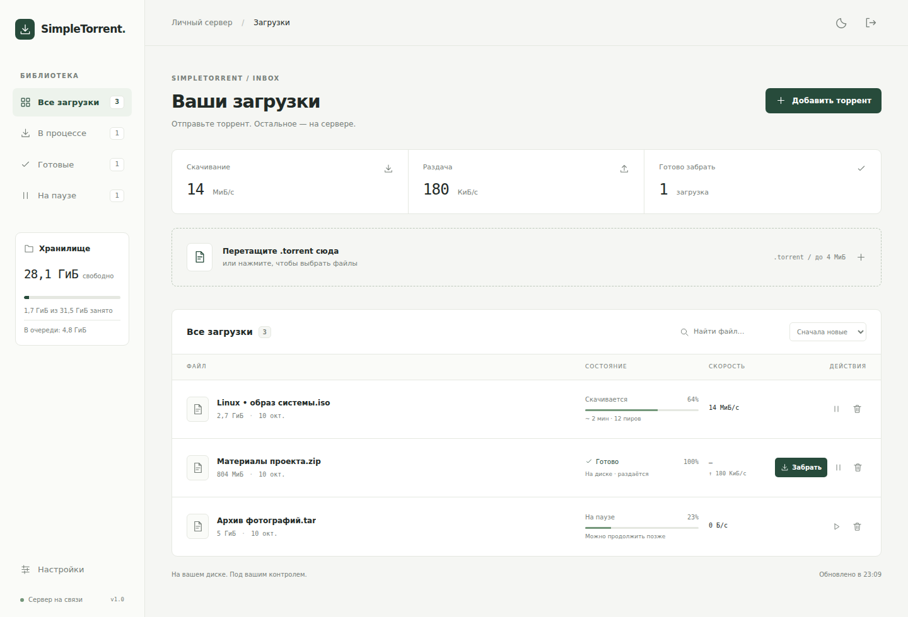
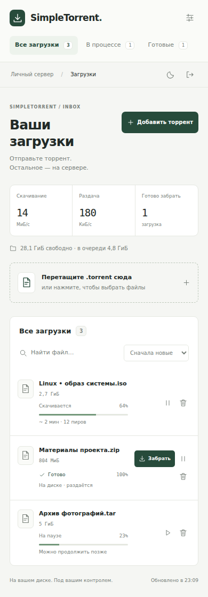

<div align="center">
  
  <h1>SimpleTorrent</h1>
  <p><strong>Скачает сервер. Заберёте вы.</strong></p>
  <p>Личная торрент-очередь для Raspberry Pi и домашнего Linux-сервера.</p>
  <p>
    <a href="https://github.com/art9762/SimpleTorrent/actions/workflows/ci.yml"></a>
    
    
    <a href="LICENSE"></a>
  </p>
</div>

Загрузите `.torrent` с компьютера или телефона. SimpleTorrent скачает содержимое на диск сервера, покажет прогресс и позволит забрать готовые файлы через браузер. Очередь продолжает работать, даже если закрыть вкладку.



<details>
<summary>Интерфейс на телефоне</summary>



</details>

## Возможности

- Несколько `.torrent` за раз: выбор файлов или drag & drop.
- Живые показатели прогресса, скорости, пиров и оставшегося времени.
- Пауза, продолжение и очередь из трёх одновременных скачиваний.
- Отдельные готовые файлы доступны, пока остальные ещё скачиваются.
- Вся загрузка одним ZIP: потоковая передача без временной копии и без сжатия, чтобы беречь процессор.
- Докачка отдельных файлов по HTTP Range.
- Поиск, фильтры, сортировка, светлая и тёмная темы.
- Адаптивный русский интерфейс для телефона, планшета и компьютера; без внешних шрифтов, CDN и фронтенд-сборки.
- Пароль, недельная сессия, CSRF-защита и лимит попыток входа.
- Проверка свободного места с учётом незавершённых загрузок; аварийная пауза при заполнении диска.
- Очередь, файлы и лимиты скорости сохраняются после перезапуска.

## Быстрый запуск на Raspberry Pi

Нужны **64-битная Raspberry Pi OS / Debian**, Python 3 для настройки, Git, Docker Engine и плагин Docker Compose. Лучше Pi 4/5 с SSD; данные можно хранить и на SD-карте. Проект не объединяет RAM устройств: скачанные файлы лежат на диске.

```bash
git clone https://github.com/art9762/SimpleTorrent.git
cd SimpleTorrent
python3 scripts/setup.py
docker compose up -d --build
```

Скрипт попросит пароль, создаст закрытый `.env` и независимые ключи для сессии и Transmission. Существующий `.env` он не перезаписывает. Для автоматически сгенерированного пароля: `python3 scripts/setup.py --generate`.

Откройте **`http://<IP-малинки>:8080`** и введите выбранный пароль. IP можно посмотреть командой `hostname -I`. Первое создание образов занимает несколько минут, особенно на Raspberry Pi.

1. Добавьте `.torrent` или перетащите несколько файлов на страницу.
2. Оставьте сервер работать; браузер можно закрыть.
3. Нажмите **«Забрать»** → скачайте отдельные файлы или весь ZIP.
4. Удалите загрузку с файлами, когда захотите освободить место.

> Приложение рассчитано на личную локальную сеть. Для доступа из поездки используйте VPN в домашнюю сеть; для публикации в интернете настройте HTTPS и обратный прокси. Не пробрасывайте порт 9091: RPC Transmission уже доступен только внутри Docker-сети.

## Где хранятся файлы

По умолчанию — в постоянном Docker volume `simpletorrent_torrent-data`. Внутри него:

```text
/data/
  config/                    очередь и настройки Transmission
  downloads/<info-hash>/     отдельная папка для каждого торрента
```

`docker compose down` сохраняет данные. **`docker compose down -v` удалит volume вместе с файлами и очередью.** Это не команда обычной остановки.

### Подключённый SSD

Сначала смонтируйте накопитель в ОС. Создайте каталог и дайте доступ контейнерам (UID/GID 10001):

```bash
sudo mkdir -p /mnt/ssd/simpletorrent/config /mnt/ssd/simpletorrent/downloads
sudo chown -R 10001:10001 /mnt/ssd/simpletorrent
```

Добавьте в `.env`:

```dotenv
ST_STORAGE=/mnt/ssd/simpletorrent
```

Затем `docker compose up -d`. Путь должен быть абсолютным, а накопитель — постоянно смонтированным до запуска Docker. Этот параметр **выбирает другое хранилище, а не переносит старые файлы**. Для переноса остановите контейнеры и скопируйте всё содержимое `/data`, включая `config`, в новый каталог.

## Настройки

| Переменная `.env` | По умолчанию | Назначение |
| --- | --- | --- |
| `ST_PASSWORD` | задаётся при настройке | Пароль интерфейса, минимум 12 символов |
| `ST_SESSION_SECRET` | случайный ключ | Подпись сессии, минимум 32 символа |
| `ST_RPC_PASSWORD` | отдельный случайный ключ | Внутренний пароль Transmission |
| `ST_PORT` | `8080` | HTTP-порт на Raspberry Pi |
| `ST_BIND` | `0.0.0.0` | Адрес публикации портов; можно указать LAN IP |
| `ST_STORAGE` | Docker volume | Абсолютный путь к каталогу на SSD |
| `ST_RESERVE_MIB` | `256` | Минимальный запас свободного места, МиБ |
| `ST_SECURE_COOKIE` | `false` | Включите `true` для HTTPS |

Лимиты скачивания и раздачи меняются в **«Настройках»** интерфейса. `0` снимает ограничение. Начальные значения: скачивание без лимита, раздача до 1024 КиБ/с. Transmission останавливает раздачу при ratio 1.0. Готовые файлы остаются доступными независимо от раздачи.

Смена пароля: измените `ST_PASSWORD`, замените `ST_SESSION_SECRET` новым случайным ключом, затем `docker compose up -d`. Смена ключа завершит старые сессии. `.env` не коммитится в Git.

Порт `51413/tcp+udp` используется для входящих BitTorrent-соединений. Для работы приложения достаточно HTTP 8080 и исходящих соединений; проброс peer-порта на роутере может улучшить доступность для пиров. UPnP отключён.

## Обслуживание

```bash
# Состояние и журналы
docker compose ps
docker compose logs --tail=100

# Остановить / запустить, сохранив данные
docker compose stop
docker compose start

# Обновить код и образы
git pull --ff-only
docker compose up -d --build

# Проверить готовность API и торрент-движка
curl --fail http://localhost:8080/healthz
```

Резервная копия: остановите оба контейнера, сохраните `.env` и всё содержимое `/data`, затем запустите контейнеры. Для SSD это выбранный каталог; для named volume путь показывает `docker volume inspect simpletorrent_torrent-data`.

Если мало места, новые торренты не добавляются. В очереди резервируется **весь оставшийся объём**, включая загрузки на паузе. Если диск заполнится другой программой, монитор раз в 5 секунд приостановит незавершённые загрузки. Освободите место и нажмите продолжение вручную.

При ошибке доступа к SSD проверьте владельца каталога и права для UID 10001. Если интерфейс сообщает, что торрент-сервис недоступен, смотрите `docker compose logs transmission`.

## Разработка и проверки

```bash
python3 -m venv .venv
. .venv/bin/activate
pip install -r requirements-dev.txt
pytest -q
node --check app/static/app.js

# Интеграция с настоящим Transmission, без публичных торрентов
# transmission-daemon должен быть установлен и доступен в PATH
ST_INTEGRATION=1 pytest -q tests/test_integration.py
```

[Архитектура, API и локальный запуск без Docker →](docs/development.md)

GitHub Actions проверяет API и безопасность, реальное скачивание из локального webseed и восстановление очереди; собирает оба образа для `linux/amd64` и `linux/arm64`, затем запускает Compose с проверкой healthcheck.

## Границы первой версии

Поддерживаются **BitTorrent v1 и гибридные `.torrent`** до 4 МиБ и 10 000 файлов; до 200 загрузок в библиотеке. Magnet-ссылки, чистые v2-торренты, выбор только части файлов, несколько пользователей и RSS пока не реализованы. Архив выдаётся после готовности всей загрузки; HTTP-докачка работает для отдельных файлов, но не для ZIP. Скачивание через HTTP ограничено скоростью сети и диска Raspberry Pi.

Пароль защищает вход, но HTTP сам по себе не шифрует трафик. Файлы не удаляются автоматически. Если удалить только запись, данные остаются на диске без ссылки в интерфейсе; повторное добавление того же торрента позволяет Transmission проверить существующие файлы.

## Лицензия

[GNU GPL v3](LICENSE). Исходная лицензия репозитория сохранена.
